

好看、流畅的 [Bangumi](https://bgm.tv) 客户端

 

### 关于「点格子」进度的重要说明

> [!IMPORTANT]
> **Chogumi 的单集进度系统完全以「看到此处」为核心逻辑，请务必在安装前了解：**
>
> 1. **默认向前顺推**：在剧集进度中**点下某一集格子，默认会将该集以及此前所有的单集全部标记为「看过」**（一次跨度较大时，会先预览要变的格子，再点一次同一格才生效，防止误触）。
> 2. **不提供单集细分状态**：这里**没有保留网页原版对单个具体剧集分别标记「想看」「抛弃」等细分状态的操作**（网页上已标的只显示，不改）。

> [!CAUTION]
> **适用建议**：**如果你的日常使用习惯高度依赖对单个剧集标记不同状态，请不要使用此应用**，以免打乱你的标记习惯。

---

### 一些特点

- **探索页建在搜索上**：探索页的每个模块都是一组搜索条件。分类、题材、年代、制作公司等多维条件可随意叠加，任何一次搜索都能固定到探索页，并以海报、书脊、焦点或年表等形态呈现。
- **系列平铺展开**：同系列正传沿着前传与续集从第一部排到最新一部，在一行内完整展开，无需层层点进关联列表。
- **长按轮盘标记**：任何地方长按作品封面，五个收藏状态与「管理」共六个圆钮顺着拇指弧度展开，滑动即选、松手即标，上方胶囊实时预览，带有撤销保护。
- **作品与个人统计**：作品页独立整理了播出前后的讨论热度与去向流向；个人主页有一张以收藏封面为底的生涯卡与全景图谱。
- **完备的社区交流**：小组、超展开、分类时间线、目录、日志与通知私信皆备。原样渲染 BBCode（图片、引用、遮罩、全套经典表情）；楼层支持按热度/最新排序、只看楼主与溯源跳转被回复楼层；编辑器自带排版工具、预览与草稿保护。
- **流畅与过渡**：优先展示本地缓存与占位骨架，点开封面自然展开为详情页，手势返回顺滑跟手。
- **常规体验**：书籍支持按话与按卷标记；深色模式、多套内置配色与平板多栏自适应布局。

还有许多细节没有写在这里，留给你在 App 里慢慢发现。

 

  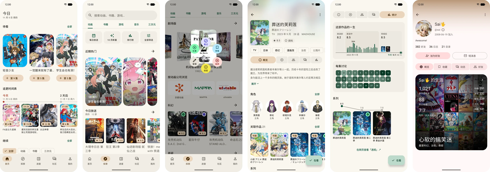

<b>更多截图</b>

| 模块样式 | 按年代浏览 | 整理模块 | 搜索 | 章节 |
|:---:|:---:|:---:|:---:|:---:|
| 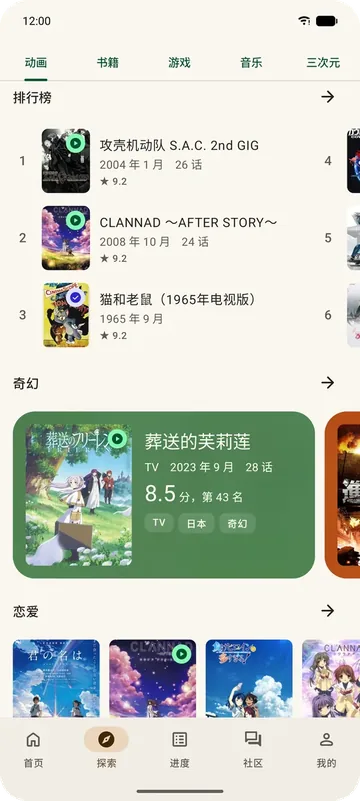 | 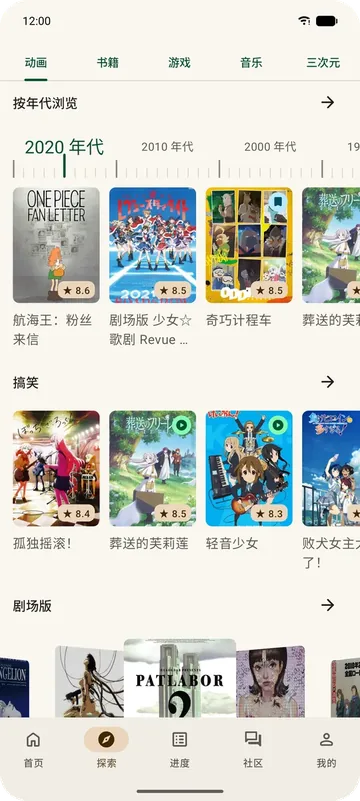 | 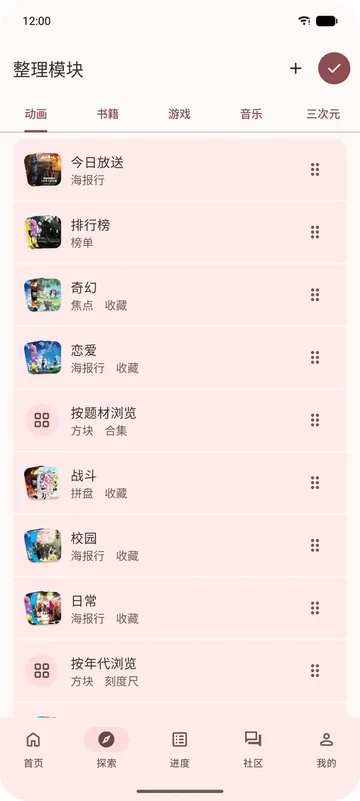 | 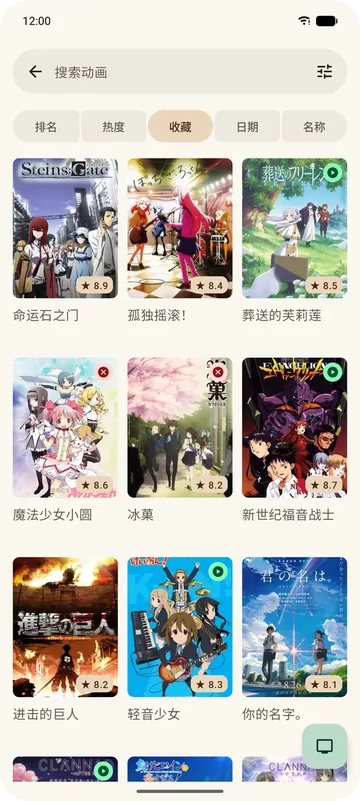 | 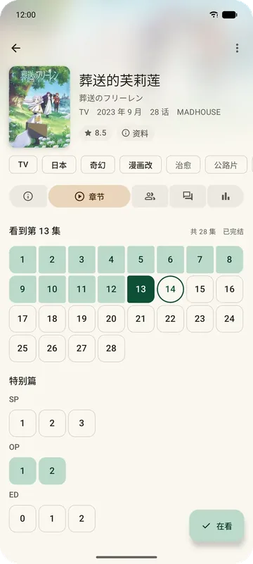 |
| **单集讨论** | **作品社区** | **角色** | **进度** | **帖子** |
| 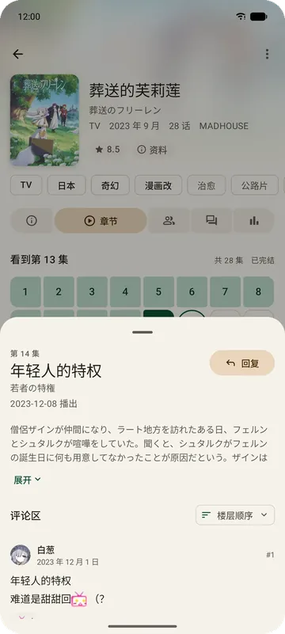 | 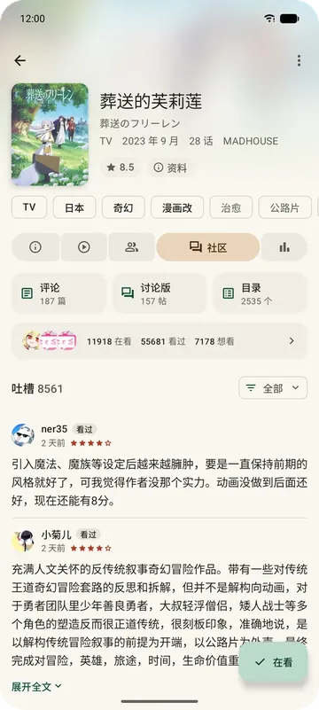 | 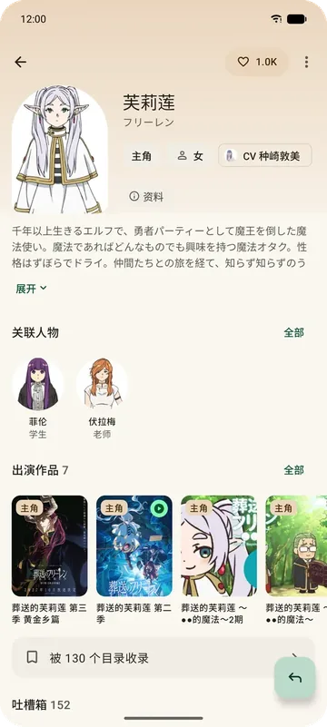 | 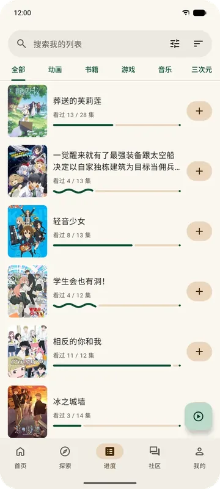 | 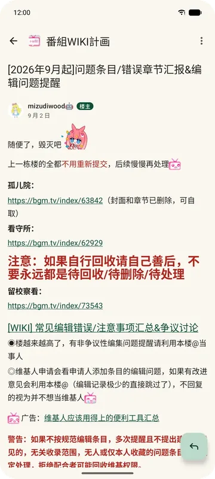 |

---

### 获取 Chogumi

可随时在 [GitHub Releases](https://github.com/TouhouGO/Chogumi/releases/latest) 获取编译完备的稳定版 APK 文件（支持 Android 7.0 及以上版本）。装好之后，App 会自动检查新版本，可以在 App 内下载并校验后安装（设置 › 更新，可以关掉）。

<b>关于账户安全与网页会话的说明</b>

 

Chogumi 的所有图表、模块排布与系列脉络均在本地组织呈现。少数操作走网页会话，需要用账号密码登录：移除作品收藏、取消收藏角色或人物、解除好友、绝交、NSFW 开关、改个人资料（头像、昵称、签名、自我介绍）、删除动态、加入或退出小组，以及短信。发帖和回复需要通过人机验证。

---

### 关于名字

Bangumi 番组计划在 2008 年起步时，开发代号叫做 **Chobits**；2009 年才正式定名为「Bangumi 番组计划」（[Bangumi 编年史](https://bgm.tv/about)）。**Chogumi** 这个名字是对前世今生的致敬。

---

  <a href="PRIVACY.md">隐私说明</a>｜<a href="https://github.com/TouhouGO/Chogumi/issues/new/choose">反馈问题</a>｜<a href="CONTRIBUTING.md">参与开发</a>｜<a href="docs/third-party-notices.md">第三方来源说明</a>

  数据来自 <a href="https://bgm.tv">Bangumi 番组计划</a> 与 <a href="https://github.com/bangumi-data/bangumi-data">bangumi-data</a>；探索页的灵感来自 <a href="https://github.com/axiel7/AniHyou-android">AniHyou</a>，在此致谢；以 <a href="LICENSE">GPL-3.0</a> 开源

