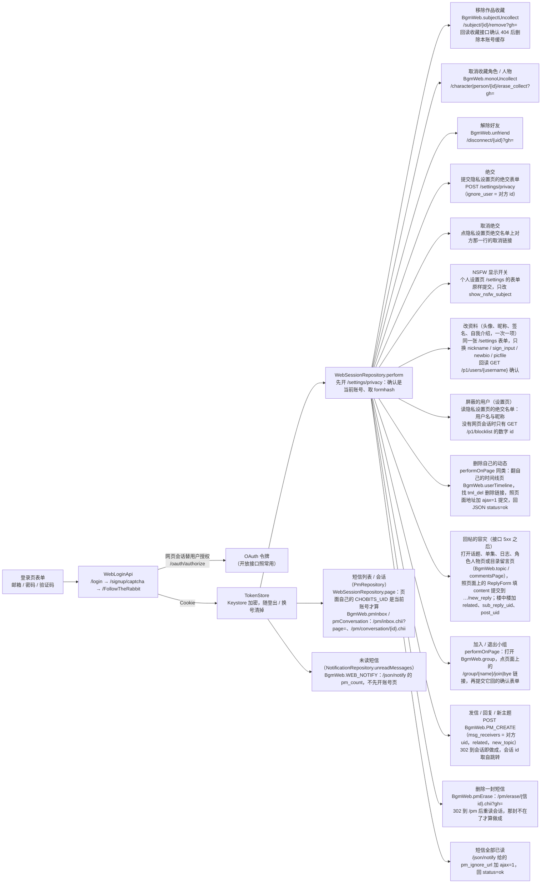

# Chogumi 开发须知

本文只写**从代码里读不出来的东西**：服务端的脾气、几个排版框架级的坑、本地环境与提交规矩。
工程规则（三条红线、各类「只许一种实现」）在 `docs/code-standards.md`，检查、PR 与设备的流程在 `docs/dev/workflow.md`，
架构与模块划分直接读代码；界面遵循 `docs/code-standards.md` 的 M3 Expressive 规则与项目现有组件。
公开资料可查 [Material Design 3](https://m3.material.io/) 和 [Android Compose Material 3](https://developer.android.com/develop/ui/compose/designsystems/material3)；项目规范副本的获取方式见 code standards。

## 0. 改什么去哪里

| 要改的东西 | 在哪 |
|---|---|
| 业务判定（集数、进度、首页分区、货架表、类型规格……） | core:model 的纯函数（`EpisodeTracking`、`subjectTypeSpec`、`exploreShelvesFor`……），界面与数据层都从这里推导 |
| 「现在」「今天」、时区 | core:foundation 的 `AppClock` / `AppTime` / `businessDateOf` / `displayZone`；界面读 core:ui 的 `LocalNow` |
| 失败与加载形态 | core:foundation 的 `Failure` / `Outcome` / `Load`；异常 → `Failure` 只在 core:network `toFailure()`，`Failure` → 文案只在 core:ui |
| 进度写入（「+」、章节方格） | core:data 的 `EpTapCoordinator` → `ProgressOrchestrator` |
| 仓库、缓存、DTO 映射 | core:data 的 `repository/`、`db/mapper/`（写入时刻显式传入） |
| 最近搜索的账号归属与后台清理 | core:data `SearchRepository`；`maintainRecentSearches` 清理失败时读取仍先认持久归属，下一次会话变化或记录搜索再清；会话本身读不出时维护结束、不崩，之后只靠记录搜索再清 |
| 生涯页的同步与同步时刻 | feature:profile `CareerViewModel`；同步时刻是本机读取，失败经 `storageOutcomeOf` 提示，刷新结束、已显示的统计与上次时刻保留 |
| 共享组件（按钮组、EP 按钮、章节方格、骨架、面板、分页、可点块） | core:ui 的 `composables/`、`common/`；章节格子的形状、集号强调、静止与预览描边只在 `TileStyle`，真实网格、演示与进度尺共用，演示的格子种类也由 core:model `EpisodeTracking.episodeGrid` 推导 |
| 选项卡左右翻页、随滚动收起的头部 | core:ui 的 `TabPager`（选中项是唯一真源，手指翻页落定才回写；上过屏的页翻走不拆，点选翻页被打断时接着当时的速度走）、`CollapsibleHeader`（收起部分 + 固定栏 + 内容） |
| 富文本、楼层、动态卡片 | core:reader；阅读字阶 `ReaderTypography`、楼层几何 `FloorGeometry` 与楼层骨架 `CommentFloorSkeleton` 在 core:ui（手势引导也画它们） |
| 名单面板（作品「谁在看」、楼层「谁贴了」） | 框架只有 core:ui `PeopleListSheet`（标题 + 筛选 chip 行 + 人物区）；谁贴了在 core:reader `ReactionUsers.kt`：状态 `ReactionUsersState` 由屏幕持有（与用户卡片一样在列表之上），楼层页画 `CommentReactionUsers`；名单来自 `CommentReactionBo.others`，「我」那格读 core:ui `LocalSignedInAccount` |
| 手势引导（只靠长按才找得到的几处，各一页会动的演示） | core:ui 的 `tour` 包：`GestureTour` 是整套页（翻页用 `TabPager`），每页一个演示（`MarkDemo` 封面长按环、`EpisodeDemo` 按住一集、`FloorDemo` 楼层长按、`ArrangeDemo` 整理探索页），都画在 `TourStage` 里（按真实 dp 排、整块缩小，字与色块是 `SkeletonSketch` 的示意图画法）。演示不另编数字：长按环就是真环的 `RingLayers`（给它一个 `RingLook`）与 `MarkBadges`，格子是 `tileFace` 与 `EpisodeTileRows`，单集面板头部是 `EpisodeHeadFrame`，楼层是 `CommentFloorSkeleton`，长按菜单是 `MenuGroups` + `AppMenuItem`、表情格子读 `ReactionGridGeometry`，整理是 `ArrangeBar`、`SegmentedItem` 打头 `CoverStack`、拖着的行按 `reorderRowColor`。这些都在 core:ui，真页面（core:reader、作品页、探索页）也从这里读：演示要的东西缺了，就把它从原处搬进 core:ui，不在演示里照写一份。改了长按环、格子、楼层菜单、整理列表的样子，演示跟着看一遍。第一次打开与升级后由外壳（`AppShell`，`ShellState.gestureTour`，偏好 `gestureTourShown`）盖在页面上放一次，设置的「使用技巧」（`Route.GestureTour`）重看 |
| 界面大小（应用的密度） | core:model `DisplayScale`（档位与收敛）→ core:ui `displayScaleOverride`（Activity 只换 `densityDpi`，dp 处处跟着走）；不在页面里改 `LocalDensity` |
| 刷新率 | core:model `RefreshRate`（档位从这块屏报的模式来，不写死）→ core:ui `requestRefreshRate`（窗口 `preferredDisplayModeId` 的唯一落点，AppActivity 调） |
| 配色与明暗 | 来源（种子色、配色方案、系统取色）只经 core:ui `themeColorSource` → `appColorScheme`，App、小组件、对比度测试同一条路；十套方案的角色色是 `PresetSchemes.kt` 的静态表（对比度由 `PresetColorSchemeTest` 守）；主题模式 → 明暗只经 `ThemeMode.fixedDark` / `darkThemeOf` |
| 设置项 | 分类名与图标只在 core:ui `SettingsSection`，分类 → 页面只在 feature:settings `SettingsPageScreen`；本地偏好加进 `PreferenceSettings.kt` 对应分类的组（`appearanceGroups`……），要读写服务端的设置另开 ViewModel（`ContentSettingsViewModel`），不加回一级菜单；一级菜单最上面自己那一行去个人资料页（`ProfileSettings.kt`，写入经 `UserRepository.editProfile`，§1.7） |
| 从外面进来的链接（OAuth 回跳、别的应用里点开的 bgm.tv 网页） | app 的 `LinkActivity`（清单里唯一挂 VIEW 的入口；登记的域名与路径和 `inAppRoute` 由 `LinkManifestContractTest` 守）→ `AppActivity.handleLink`；应用里没有的页交给浏览器（`CustomTabUriHandler` 指名浏览器，不绕回自己） |
| 桌面小组件 | feature:home 的 `widget/`：内容与首页同一个 `prepareSectionCandidates`（`WidgetWorksSource`）、热力图与生涯同一份统计、今日放送与本周追番与每日放送页同一个 `followedWorksOf` → `calendarWeek`（`WidgetCalendarSource`）；+1 只经 `EpTapCoordinator`（`ProgressOrigin.WIDGET`）；什么时候重画只经 `WidgetUpdates`；配色 `WidgetPalette` 经 `appColorScheme` |
| 检查更新、应用内下载 | 要不要提示、到没到检查时间、更新说明去标记只在 core:model `updateOfferOf` / `updateCheckDue` / `releaseNotesTextOf`；检查、忽略、下载与 sha256 校验只在 core:data `AppUpdates`（应用作用域，`App.kt` 按回到前台调 `watch`）；提示框与安装在 app 的 `AppUpdateDialog` / `installApk`；设置页是 feature:settings `UpdateSettings.kt`。数据源是最新正式 Release 附带的 `release.json`：`versionName`、`versionCode`、`sha256` 是客户端契约，安装包 = `sha256` 表里唯一的 `.apk`，改 `formal_release.py` 的结构或附件命名前先看 `releaseOf`（§4.5） |
| 连 bgm.tv 走哪条线路（系统网络 / 直连） | core:netroute：线路设置与核心起停 `NetRoute`、给网络层的调整 `DirectRouting`、边缘地址来源 `EdgeAddresses`、设备支不支持 `directRouteSupported`；网络层只认 core:network 的 `OkHttpCustomizer`（三个接口客户端与图片加载都套上）。直连核心的 Go 源码在 `core/netroute/go/`，改了跑 `tools/echcore/build.sh` 重新生成 `core/netroute/libs/echcore.aar`；别处不引用核心（`python3 tools/guards/check_netroute.py`）。设置页「网络」与登录页的地球、「试试直连」都读同一份设置（§1.10） |
| 字符串、图标 | core:res（字符串中英两份；图标只经 `tools/icons/material_symbols.py`） |
| 路由 → 页面、导航状态 | app 的 `AppEntries.kt`；core:ui 的 `AppNavigator` |
| 一个页面 | `feature/<名字>/`：Screen + ViewModel + `di/<名字>Module.kt`，feature 之间不互相依赖 |

## 1. 服务端与数据

### 1.1 分页：一页回不满不代表到底了

Bangumi 服务端先按 `limit / offset` 切数据库结果集，再跳过查不到的条目（发布者已注销、内容不可见、NSFW 过滤），
所以**一页回不满、甚至整页为空，都不代表这是最后一页**。按返回条数推进游标会重复扫描、静默丢页、
把「第一页全被跳过」误判成没有数据。

唯一实现：`core/data/.../repository/PagedCursor.kt` 的 `nextCursor(...)`（三条规则与实测数字写在函数上）；
列表侧的取页、续取与作废旧请求只经 core:common 的 `Pager`；数据层一次取全（收藏、章节、逐集状态、角色、关联、人物作品、标签目录）只经同一文件的
`fetchAllPages`：第一页拿到 `total` 后其余页一起发，长篇的十几页只多一轮往返；没有 `total` 时逐页往后取到空页为止；
某页与上一页完全相同（翻页没前进）按坏响应失败。只要前若干行时给 `maxRows`；后台取几十页时传一份 `permits`（几次取全共用，
第一页也要先拿许可）限在途页数；要报进度时传 `progress`。不要再写第二份。

### 1.2 先查服务端支不支持

改需求前先看仓库中的 API 契约（`tools/openapi`），并在可行时实测；推断经常是反的。可公开访问的上游及快照来源见 `tools/openapi/sources.json`。
已知的服务端故障（不是我们的 bug）：

- 取消收藏角色 / 人物：已收藏时 `DELETE /p1/collections/characters|persons/{id}` 恒 500（带不带请求体都一样），
  v0 的 `DELETE /v0/characters|persons/{id}/collect` 没有实现（404）；
- 解除好友：`DELETE /p1/friends/{username}` 恒 500；
- 绝交、取消绝交：`PUT|DELETE /p1/blocklist/{username}` 恒 500（与 `PATCH /p1/privacy` 写同一张用户字段表）；
- `PATCH /p1/privacy` 恒 500（NSFW 显示开关）；
- 删除自己的动态：`DELETE /p1/timeline/{id}` 实测 500（权限与频率检查之后的事务或解码出错）；
- `/p1/subjects` 浏览漏传 allowNsfw。
- 回复个别话题恒 500：11-08 实测，站务论坛话题 475294 回复楼主两次都是 500，同一账号在沙盒话题回复正常，假的验证令牌回
  `CAPTCHA_ERROR`。所以验证令牌校验没问题，失败发生在验证通过之后的写入事务里（写楼层、更新回复数、给楼主发提醒）。
  只有这个话题失败，推断卡在给这位楼主发提醒那一步（`Notify.create`），没有实测到具体原因。网页旧站的回复走另一套代码，
  这个话题在网页上能回，所以回复改用网页会话补（§1.7「回帖的容灾」）。

网页端能做是因为它用登录 Cookie 走网页链接，OAuth 令牌拿不到那条路。前几项（取消收藏、解除好友、绝交、NSFW、删除动态）因此改走网页会话（§1.7）：写接口的 5xx 经
`onWebIfServerError`（core:data）用网页会话做同一件事，再回读接口确认；没有网页会话时提示要账号密码登录，网页也没做成时
才是「去网页端操作」。其余只做回滚与提示，界面说清楚去哪里做，不报通用的「服务器开小差了」。

### 1.3 凭证与偏好分开存

- `chogumi_tokens.preferences_pb` 只放凭证与会话键（键名由 `TokenStoreKeys` 统一定义），
  `chogumi_preferences.preferences_pb` 只放用户偏好。两个文件损坏时各自重置为空：令牌文件坏了就是登出，不影响偏好。
- 界面大小档位是唯一不在偏好 DataStore 里的偏好：Activity 在 `attachBaseContext` 里、第一帧之前就要同步定下密度，
  所以单独存在 `chogumi_display` 这个 SharedPreferences 文件里（`DisplayScaleRepository`），随备份走。
- 单部作品小组件选的是哪部存在 Glance 给每个小组件的那份状态里（按小组件 id 分文件），不在偏好里：它只对这台机器上的这个小组件有意义。
- 本地数据库是缓存（条目、收藏、首页进度都能从服务端重拉）：升版本写迁移，导出的 schema 在 `core/data/schemas/`；
  装回旧版本时整库重建，不为降级写迁移。
- 系统备份只留偏好设置：令牌文件、数据库、表情缓存、崩溃记录、WebView 数据都排除（`app/src/main/res/xml/backup_rules.xml` 与 `data_extraction_rules.xml` 两份规则保持一致）；换机恢复后要重新登录，缓存从空开始。
- 令牌不用 Keystore 硬件加密：威胁模型不含「拿到已解锁手机提取私有目录」，而 Keystore 在锁屏凭据变更或 OEM 异常时会偶发
  密钥失效导致强制登出。网页会话的 Cookie 例外，用 Keystore 的 AES-GCM 加密后存在同一个文件里（`KeystoreCookieCipher`）：
  它能做网页上的一切，而密钥失效的代价只是丢掉网页会话（解不开就当没有，提示重新用账号密码登录），不会登出。

#### 令牌的有效期与刷新

- 账号密码登录与浏览器授权都是拿授权码换令牌（`AuthApi.exchangeCode`）：每换一次，服务端新发一张 OAuth 令牌，
  bgm.tv 的「个人令牌」页按应用名列出（「Chogumi」）。令牌有效期由服务端定为 7 天（`expires_in` 604800），客户端改不了。
  手动填的 Access Token 原样存下，不新发。应用不创建个人令牌。
- 登录靠刷新延续：请求挨 401 时 `TokenRefresherImpl` 用 refresh_token 换一对新令牌，不主动按 `expires_in` 刷新。
  刷新请求按 bgm.tv 授权文档带齐 `grant_type`、`client_id`、`client_secret`、`refresh_token`、`redirect_uri`
  （与换授权码同一个值）。refresh_token 的有效期文档没写；刷新在线上的结果未实测（推断）。
- 登出只清本机的令牌，不在服务端作废：OAuth 没有公开的作废接口，令牌页的删除是 next.bgm.tv 的网页操作，不在接口合同里。
  旧令牌到期自然失效。

#### 浏览器 OAuth 的已接受风险

账号密码登录是主入口；浏览器授权是次要入口，打开浏览器前有确认框。浏览器回调保留 `chogumi://oauth/callback`：
其他应用可以声明相同的自定义 scheme，可能截获授权码。`AuthRepository` 校验并一次性消费 `state`，防止伪造或重放回调，
但不能防止授权码被截获。

`CLIENT_SECRET` 经 `BuildConfig` 编入 APK，混淆不能让它保密。当前接受这一风险；待 bgm.tv 服务端支持 PKCE 后，
改用带 PKCE 的公共客户端。

### 1.4 多身份 HTTP 客户端

`loadTokens { null }` 与不置 `AuthCircuitBreaker` 是**刻意的**：同一个客户端由多个身份共用，令牌必须由每个请求
经 `pinSessionToken` 显式指定（见 `createHttpClient` 的注释与 `SessionRequestTest`）。别「优化」回去。

### 1.5 表情

表情代号与素材的唯一映射是 `core/common/.../bbcode/SmileyCatalog.kt`；常用的一批内置，其余经 `SmileyAssetStore`
按需下载并持久缓存。界面层不手写表情代号或路径。

### 1.6 时间线不能按类别查

`/p1/timeline` 与 `/p1/users/{u}/timeline` 只有 `limit`（最多 20）和 `until`（动态 ID），没有类别参数；
带 `cat` 的只有实时推送 `/p1/timeline/-/events`，不能取历史。动态页的类别因此是客户端筛已取到的列表，
不够一屏就往前翻页（`feature/timeline/.../TimelineScan.kt`：一轮取到多出一条为止，连续 400 条不同类先停下等用户点继续）。

- 全站（`mode=all`）只读服务端缓存，缓存每 10 分钟截到最新的 1000 条：往前翻约 50 页就是空页（10-13 实测
  54 页、1051 条、约一小时）。冷门类别在全站里往往只有几条，这是服务端的上限，到底时页脚说明。
- 好友（`mode=friends`）缓存不够时回落到数据库，能一直翻到最早。
- 天窗（cat 9）的 `memo` 恒为空对象，画不出是哪部作品，所以类别里没有天窗。
- 网页端旧站的 `/timeline?type=…` 能按类别筛，但那是网页 HTML：匿名只有全站、每类只有最近 20 条且不能翻页，
  好友要登录 Cookie（§1.7，还没接），所以不接。

### 1.7 网页会话（Cookie）：开放接口做不了的事

有些事只有 bgm.tv 网页能做（写接口恒 5xx，或根本没有接口，如站内短信），网页认的是登录 Cookie，不认 OAuth 令牌。账号密码登录
（登录页的表单：邮箱、密码、验证码）一次拿到两样：先提交网站的登录表单拿到 Cookie，再用这个网页会话替用户在 OAuth
授权页点「授权」、换令牌。浏览器授权与手动 Token 登录拿不到 Cookie，网页才有的操作提示要账号密码登录。
回复与举报通过 p1 POST 接口携带 OAuth 令牌提交；回复在接口 5xx 时用网页会话补（下面「回帖的容灾」）。

网页会话的 Cookie 和 User-Agent 绑在一起：服务端解登录 Cookie 的密钥是站点密钥加请求的 UA（`legacySessionAuth`），UA 一变，
存着的会话就解不开、网页那边当作没登录。网页请求（登录与会话）的 UA 因此是不带版本号的固定值 `WEB_USER_AGENT`，永远不改；
开放接口的 UA 照常带版本号。登录时不勾网页上的「不保存我的登录状态」（`cookietime`），拿的是长效 Cookie，有效期由网站定，没实测。



- 链接只由 core:model `BgmWeb` 拼（`check_web_links.py`），打开只经 `WebSessionRepository`（`perform` 等）：操作前先确认网页上登录的
  还是当前账号（`CHOBITS_UID`），没登录、换了人、Cookie 解不开都丢掉会话并抛 `WEB_LOGIN_REQUIRED`。
- API 写入、Cookie 补偿与确认回读共用操作起点的 `AccountSession`。收藏以外必须登录的写操作都经 `authenticatedOutcome`（收藏写入走 `CollectionEditing` 与条目锁），
  网页 Cookie 由 `TokenStore.webSessionFor` 在同一凭证快照中取得；每次网页 GET / 确认 POST 发送前和响应后都校验会话，
  换号或登出后结果成为 `Failure.SessionChanged`，不读取新账号的 Cookie 或把新账号的回读当成旧操作成功。
- 有的操作链接先回一页提交到自己的 POST 确认表单（加入、退出小组），`WebSessionApi.follow` 照页面提交（隐藏字段与提交按钮）。
- 网页对操作链接只回一个跳转，没有契约：做没做成一律回读开放接口确认（角色 / 人物收藏看 `collectedAt`，好友看好友列表，小组看 `membership`），
  回读仍未生效就是「去网页端操作」。移除作品收藏回读当前账号的收藏接口：只有 404 才删除本账号的本地收藏与章节状态，其他结果保留缓存并报失败。
  绝交、取消绝交回读 `GET /p1/blocklist`，NSFW 开关回读 `GET /p1/privacy`。
- 个人设置页 `/settings` 的表单（`name="set"`）是分段上传（`multipart/form-data`），字段依次是 formhash、nickname、sign_input、
  picfile（文件）、username、newsite、newbio、show_nsfw_subject、timeoffsetnew、submit。NSFW 开关与改资料共用 `WebSessionApi.editSettings`：
  现读这一页，`editedPostForm` 只换要改的那几项、其余照页面现在的值，按表单自己的编码提交；要改的项不在、类型不对或被禁用就不提交。
  每次提交都带整张表单，读页到提交完成一次只走一回（`editSettings` 里的锁）：两回交叠时都读到同一张旧页，后交的把先交的那项改回旧值。
  App 只改头像、昵称、签名、自我介绍（`ProfileChange`，用户名、个人主页这些与账号安全相关的不改）。回读 `GET /p1/users/{username}`：
  文字按 `ProfileChange.normalized` 的样子比（自我介绍回的是 `\r\n`），头像回读不到内容，看地址变了没有（每换一次 `?r=` 后的时间戳就变）。
  头像先在设备上居中裁成正方形、缩到 512px、压成 JPEG（`DeviceAvatarImages`）。自己的资料页上昵称、签名、头像取 p1 的那份（`mergeProfile`），
  与回读确认的是同一份；改成之后 `UserRepository.editProfile` 回回读到的资料，个人资料页直接用它（`withProfileOf`），
  `UserRepository.profileEdits` 加一，设置与自己的主页跟着重读。本地用户缓存不存自我介绍、个人主页、所在地，`getMe` 在 p1 取不到时
  也退回只有基础资料的 v0；个人资料页只画网上读到的 p1 那份（`UserRepository.getEditableProfile`，取不到就是加载失败）：
  拿缺自我介绍的资料打开面板，空着的自我介绍一保存就把网页上的清掉。
- 回帖的容灾（`replyWithWebFallback`，话题与评论区都经它）：这个账号有网页会话时，发送之前先读一遍楼层作基线；接口回 5xx，
  再读一遍，我在这一层下多出来的、基线里没有的、正文就是这一句的楼就是这一次的（接口其实写进去了，不再发）；没有就照网页的回复表单提交，
  再读一遍认出它。基线排除刚发过的同一句（不按时间窗），比正文排除同一账号在别处同时发的另一句；接口回的正文可能转义过 HTML 实体，
  原样与解开实体后的都算。代价是有网页会话的账号每次回复多读一遍楼层。
  回读不到是「去网页端回复」；没有网页会话、不是 5xx 的失败原样给出。网页的回复表单（2026-11-08 实测，话题、单集、日志、角色、人物、
  目录六类同一张 `ReplyForm`：formhash、lastview、content、submit）没有人机验证；表单上出现 Turnstile 就不提交，网页这条路只在用户
  已经过了验证、接口失败之后走。动态的回复不补：网页的动态回复只提交正文（推断，没实测表单），没有「回复哪一条」，补上去会丢掉回复对象。
- 删除动态例外：网页回 JSON，`status` 为 `ok` 即做成，不回读。动态读取（`/p1/timeline/{id}/replies`、用户时间线）走服务端缓存，
  由异步事件清，刚删完仍读得到，回读会把做成了的删除当成失败；本地列表直接摘掉这一条。
- 资料（`GET /p1/users/{username}`）上的计数不跟列表同步：`stats.friend` 是服务端缓存的计数，取消好友后要过一阵子才变
  （2026-11-07 实测：取消一个好友后好友列表 `total` 当即是 5，`stats.friend` 还是 6），`stats.index` 与目录列表口径不同。
  资料头的「好友 N」「目录 N」都取对应列表端点的 `total`（`UserRepository.withProfile`），与 tab 里的列表同一来源；自己的主页
  跟着好友名单（`FriendsRepository.changes`）与目录写入重读，在别处加、取消好友或改目录之后不等下拉刷新。
- 绝交即屏蔽：名单以服务端 `GET /p1/blocklist` 为准，`BlocklistRepository` 按账号缓存（偏好 DataStore，一小时后后台重读），
  绝交、取消绝交做成后记下服务端给的完整名单。楼层（话题、日志、目录、角色人物吐槽、单集评论、动态回复、作品吐槽）在显示时按页面
  当前的名单藏：页面订阅 `BlockedUsersFeed`，`visibleThread` / `topicFloors` 按它拿掉（楼层号跳号），所以在这一页长按绝交、
  在别处绝交或取消，已显示的楼层当场跟上，不重新取。帖子、时间线、长评这些列表由数据层取时按名单拿掉（`BlockedUsersSource`），
  游标仍按原始页推进；某人的个人时间线、「我的帖子」不过滤。
- 短信（开放接口没有）全部走网页，以网页为准。读页面（列表、会话）不先开账号页：每个网页都写着登录的是谁（`CHOBITS_UID`），
  是当前账号就用；不是、或页面回跳转，再开账号页确认（失效照常丢掉会话、要账号密码登录）。打开会话网页就算读过，读完重读未读短信。
  发信成没成看跳转：跳到 `/pm/conversation/{id}.chii` 就是发出去了（会话 id 取自那里），停在写信页时原因只认输入框旁 `span.alarm`
  的那一句（`pmRejectionOf`：收件人不存在，其余是没发出去）。收件人一律传数字 uid。删信不是撤回，只删自己这边。
  未读短信读 `/json/notify`（网页顶栏读的同一个），常读，不先确认账号；没有网页会话时为 0、不发请求。
- 读网页只用 jsoup，按元素与样式类取，不用正则匹配标签：整页走 core:network 的 `webDocumentOf`；短信正文取
  `.pm-message-body` 的 HTML 原样（输出不重排），数据层用 core:common 的 `bbcodeOfHtml` 还原成 BBCode，和帖子走同一个渲染器。
- 网页登录的失败原因只认网站出错页的那一句（`signInRejectionOf`：验证码错、邮箱或密码错，其余按登录没成功）。
- **新接一个依赖 Cookie 的功能，在上图加一条边**（功能名、`BgmWeb` 里的拼法、网页路径），图就是全部依赖 Cookie 的清单。

### 1.8 内存缓存与公司名单

- 按条目键存的内存缓存（每部作品、每个用户一份）一律用 core:data 的 `LruMap`，有上限、按最近使用淘汰；不写无界的 `HashMap` 缓存。
- 探索页的公司名单只在 core:model 里一份；改名单后跑 `python3 tools/check_companies.py`（只读，对照线上核对每条的 ID 与名字）。

### 1.9 接口的事实（线上实测）

下面是在线上量过的，默认可信；有相反的证据就再量一次，并改这里。

- 章节：`sort` 是全系列连续的，`ep` 是本条目内的（银魂' 的 sort 202–252、ep 1–51）；界面一律经 `formatEpisodeSort` 显示 sort。
  进度是从逐集状态算出的「看到第 X 集」，`ep_status` 是计数、不是集号。零集作品存在：章节接口成功取完、服务端总数为 0，
  就是「这部作品现在没有章节」，是正常结果，不是失败。
- 收藏 PATCH：`ep_status` / `vol_status` 只对书籍有效（其他类型 400）；动画进度用逐集 PUT 或批量 PATCH；不适用的字段传 null，不传 0。
  未收藏作品上的逐集 PUT：404，或含 "not collected" / "collection first" 的 400；其他 400 重抛；绝不顺带创建收藏。
- core:network 的 DTO 同时绑定 OpenAPI 合同，没有调用方不等于死代码；删之前在 `tools/openapi` 跑
  `node refresh.mjs --check && node check-coverage.mjs`。
- 关联的 `offprint`：省略或 false = 只有非单行本，true = 只有单行本（1003）；要全部就两次请求按 id 去重。`order` 是卷号。
- 浏览与搜索：按排名、收藏数排序走 v0 search（`total` = 条目数，上限 1000）；按热度、日期、标题走 p1 `/p1/subjects`
  （`total` = 页数，随排序变）。匿名请求被去掉 NSFW；只有游戏的热门能验 NSFW 过滤，先读真实的 DataStore 开关。
- `SearchDimension` 的选项增删前在 p1 上逐个实测（每个选项一个 `limit=1` 的请求）；`core/model` 测试资源里的 v0 审计表量的是别的东西。
  meta tags 只按 AND 组合；v0 的 `filter.tag` 只看 30 个标签的快照；`tag` 与 `meta_tags` 是两回事，不混用。
- 标签目录：`/p1/channels/{type}/tags` 的前 5000 个。公司与人物的作品：`/p1/persons/{id}/works?position=`（动画制作 67，导演 2）。
- `/p1/notify` 的 `total` 不管参数恒为全部未读数。时间线没有类别参数、`limit` 最多 20（§1.6）。
- `/p1/persons/{id}/casts` 的 type：1 主役、2 配角、3 客串、4 次要、5 旁白；各选项的数量用各发一个 `limit=1` 的请求取。
  角色、人物的评论不分页。
- p1 的时间戳是 Unix 秒；目录关联项的 cat 0 = 条目。
- 贴贴（`reactions`）带完整名单：每个表情的 `users` 是贴了它的每一个人（`id`、`username`、`nickname`，一楼 78 人也全给），不分页、不截断。
  「谁贴了」的面板就画这份名单（`CommentReactionBo.others`），不另外请求；我从名单里拿出来记成 `selected`。名单里没有头像：
  头像走 `https://api.bgm.tv/v0/users/{username}/avatar?type=large`，自定义头像 302 到图片，默认头像 404（格子画占位）。
  这个入口要应用的 UA：okhttp 默认 UA 与空 UA 都回 403。图片加载器对 `api.bgm.tv/v0/` 的请求补上开放接口同一个 UA（app 的 `ApiImageUserAgent`）。
- 进度页按类别（meta_tags）筛选用本地 subjects 表，不逐作品请求。
- bgm.tv 的用户页偶发 500 / 502：截图里的失败提示是服务端的事，重拍。
- 放送时刻来自 bangumi-data，取 GitHub 上 master 的原始文件：`https://raw.githubusercontent.com/bangumi-data/bangumi-data/master/dist/data.json`。
  上游每次合入 master 由 CI 重新构建这个文件并发 npm 版本（2026-11-01 与 npm 最新的 0.3.234 逐字节相同）。约 7.9 MB（gzip 1.5 MB），
  `content-type: text/plain`（不能交给内容协商解码），`cache-control: max-age=300`，带强 ETag，`If-None-Match` 回 304
  （云端经代理、Mac 直连与应用内都实测过：第一次 200、之后 304；应用存的是 gzip 传输时的弱 ETag `W/"…"`，带回去照样 304）。
  不用 jsDelivr 的 `bangumi-data@0.3`：边缘缓存 `s-maxage=43200`（新版最多晚 12 小时才到），带 ETag 仍回 200，版本范围也会停在 0.3.x。
  `AiringTimeRepository` 6 小时最多取一次，打开首页、每日放送，或小组件每小时刷新（`WidgetRefreshWorker`）时顺带调。每周播出写在 `broadcast`：
  `R/<带时区的 ISO 时刻>/P7D`（也有 P0D、P1D、P1M 与空串，只认 P7D）；条目 id 在 `sites[].site == "bangumi"` 的 `id`，同一 id 会出现两次
  （取 `begin` 晚的那条）。bgm.tv 放送表的星期按 UTC+4 的日期归（一季 73 部对上 71 部），首播落在别的放送日就不显示时刻。
- bgm.tv 章节的 `airdate` 也按放送日归：深夜番（日本时间 0 点到 4 点开播）的每一集都写前一天的日期（2026-10-31 对 5 部实测，
  如周二 02:00 JST 开播的每集都是周一），与放送表的星期同一套归法；所以首页追更时间表按 `airdate` 的星期查放送时刻（`airingMinuteOf`）。
  bgm.tv 放送表不收全部在播作品（国产动画、部分新番不在表里），在追作品哪天播只看下一集的 `airdate`（`followedAiringDateOf`），
  首页与每日放送的「我在追」同一个判定；本机还没有这部的章节时才退回放送表的星期。

### 1.10 直连（ECH）的事实（2026-11-09 线上实测）

- bgm.tv、api.bgm.tv、next.bgm.tv、lain.bgm.tv 都在 Cloudflare 上，解析到 104.26.8.23、104.26.9.23、172.67.73.67；bgm.tv 自己的
  DNS 没有发布 ECH 配置。Cloudflare 的共用配置（public_name `cloudflare-ech.com`，71 字节，chii.in 的 HTTPS 记录里有同一份）对这四个
  域名都被接受（`ECHAccepted`），证书是 bgm.tv 的。
- 配置不对（公钥随意的一份）时 Cloudflare 拒绝并随拒绝给出当前配置，用它重连就成功；所以核心内置一份随意的配置即可自举，
  拿到的那份存进 core:netroute 的 DataStore，冷启动直接用。
- 不是每个 Cloudflare 地址都服务 bgm.tv：104.16.132.229 握手成功但回 403「error code: 1034」（边缘地址受限），核心见到就换下一个地址。
  TCP 通了而 TLS 卡住的地址也只耽误一份预算：每个地址的拨号加握手预算是客户端一次请求的超时分成「地址数 + 1」份
  （core:netroute `edgeBudgetMillis`），失败的首选让给下一个地址。
- 线路设置的观察拍只负责触发同步：`NetRoute.transition` 在起停核心的同一把锁内经 `mode` 重读当前设置，
  启动或排队期间取到的旧拍不能停掉用户刚开好的核心；读失败仍按 `mode` 的系统网络与退避恢复规则处理。
- 大陆线路（Mac 有线、出口 CN）上：普通 SNI 连 bgm.tv 各地址约 40ms 被重置（线路中注入，早于服务器的回包）；ECH 外层 SNI 是
  `cloudflare-ech.com`，不被重置，10 分钟 120 次请求全部成功。对同一地址连发几次普通 SNI 之后，几十秒内连 ECH 也被重置
  （推断：两次观察，没量出时长）：直连失败时绝不退回普通 SNI。
- 同一线路上国内 DNS（运营商、223.5.5.5、119.29.29.29、114、doh.pub、阿里 DoH）给 bgm.tv 与 chii.in 都回假地址；dns.google、
  cloudflare-dns.com 的 DoH 连不上。所以边缘地址内置，不靠 DNS。
- 直连只管 OkHttp 的请求（接口客户端与图片加载）。应用里的 WebView（回帖的人机验证页）与浏览器（浏览器授权、打开网页）不经过它。

## 2. 排版框架级的坑

### 2.1 行内遮罩 `[mask]` 不走 48dp 热区

48dp 最小触控热区适用于独立的交互控件；与文字同处一条文本流的行内元素（遮罩）豁免，按官方网页的行内排法：
遮罩高度就是一行字，强撑到 48dp 会把整行文字撞开。判断口径：「这是行内元素，还是独立控件？」
`BBCodeMaskRenderTest` 钉住了「遮罩不加 `MinTouchTarget` / `sizeIn`」。

### 2.2 遮罩不能用 `InlineTextContent` 占位符

`InlineTextContent` 在排版里是一个不可折行的固定矩形：单行槽位会冲出屏幕，多行槽位会整块换行、压住前文、
把下一行空白处涂满底色。遮罩用 `AnnotatedString` 内联 `SpanStyle(background = 同色)` 配合 `LinkAnnotation.Clickable`，
底色只画在字形下面，逐字折行。

### 2.3 富文本外层不许查固有尺寸

富文本组件里有 `SubcomposeLayout`：`FoldableText` 要在同一次测量里定下「超出才折叠」，`BBCodeImages` 用
`BoxWithConstraints` 按列宽排图。`SubcomposeLayout` 一被问固有尺寸就抛
`IllegalStateException: Asking for intrinsic measurements of SubcomposeLayout layouts is not supported`；
泛型 layout modifier 的默认固有尺寸实现还会把测量回调当探测来调（不可知的那一轴填 32767），折叠判定每帧翻转。
所以 core:reader 的任何组件外层都不用 `IntrinsicSize`：要和内容等高的线（楼中楼左侧的树枝线）在内容列上 `drawBehind` 画。
门禁 `tools/guards/check_intrinsic_size.py`：`IntrinsicSize` 只许出现在白名单函数里，且这些函数不调用 core:reader 的组件。

### 2.4 行内序号只在一段文字里用

`BBCodeText` 用「行内遮罩序号」记哪些遮罩已揭示（`revealedMasks`，按本段内容记忆）。这个序号只在当前这段文字里有意义，
**不能拿去当列表 key 或全局 ID**——混入下标的 key 出过重复键崩溃。

### 2.5 等值的新对象跳不过重组

强跳过下，可组合项比较参数有两种口径：编进 Compose 的类、接口（`List`、`Load`、`Failure`……）按 `equals`；
没有编进 Compose 的模块（core:model、core:data、`java.time`）里的具体类只认同一个实例，ViewModel 重算后发出的新对象
内容没变也照样重组。`gradle/compose-stability.conf` 列出按 `equals` 比较的外部类型（`core.model` 的模型、`LocalDate`），
由 `chogumi.android.compose` 交给每个 Compose 模块；只列没有可变状态的类型。`StabilityConfigurationTest`（core:ui）
钉住配置接上了。哪些参数还按实例比较，看编译器报告：`./gradlew compileDebugKotlin -Pchogumi.composeReports`，
各模块的 `build/compose-compiler/*-composables.txt` 里标 `unstable` 的就是。

### 2.6 桌面小组件（Glance）

- 一层 `Row` / `Column` 最多放 10 个子项，多的被截掉、不报错：热力图一个月的格子按 10 个一组再套一层（`HeatWidget.kt`）。
- 会话还开着时（Glance 在最后一次更新后留它一会儿）`updateAll` 不重跑 `provideGlance`，只重读 Glance 自己的状态：
  要重读的数据挂在 `WidgetUpdates.revision` 上（`provideLiveContent`），不靠 `updateAll` 重新进 `provideGlance`。
- 颜色与文字在本进程按当前配置算好再交给桌面（不是桌面按系统主题解析的资源）：「系统取色」读的系统配色、界面语言都跟着进程的配置走。
  换壁纸后系统换配色，进程收到的是一次配置变更，所以配置变更是重画的输入之一（`widgetInputs`）。进程不在或被冻结时收不到，
  下一次 App 启动（`startIfPlaced` 先画一遍）或每小时的刷新补上。
- 每小时的刷新（`WidgetRefreshWorker`）不要求联网：取数断网时各自失败，按本机的数据照样重画。今日放送、本周追番的「今天」在北京时间 4 点翻页，
  只有这一下跟时间走，要求联网的话断网跨过 4 点就一直停在前一天。
- 一次更新的全部位图走同一个跨进程包（上限约 1 MB）：封面按最多 2 倍像素密度取、列表最多取 6 张、本周追番最多 24 张小封面（`coverBitmapsOf`）。
  同一张封面在各个尺寸里共用，按用到的最大尺寸取一次，画的时候缩小。
- 排法随尺寸（`SizeMode.Exact` 的 `LocalSize`）：作品列表（在看、今日放送）只画放得下的整行（`listLayoutOf`），不用 Glance 的 `LazyColumn`
  ——它在固定高度里会露出被切掉一半的下一行；单部作品按尺寸选一行、左边大封面或海报（`subjectLayoutOf`）；本周追番按列宽定封面、
  按列高定一列几格（`weekLayoutOf`）。
- 一格多高由桌面定（同是 4×1，有的约 60dp，Pixel 桌面约 107dp）：排法的界线按「放不放得下」定，测试里放真实桌面量到的尺寸。
- 换尺寸时桌面把新的画法套在已有的视图上，没写的属性留着上一个尺寸的值：会随排法变的宽每次都写一遍（`ProgressButton` 的 `wrapContentWidth`）。
- 小组件不在 Compose UI 的组合里，没有 `LocalResources` 这类 CompositionLocal：要共用的文案函数各有一个收 `Resources` 的版本
  （`collectionProgressLabel`、`dayOffsetLabel`），组合里的同名函数只是转交。
- 点击是一次广播，广播结束后进程随时可能被回收：+1 的回调挂起到协调器这一轮写完（`WidgetProgressActions.advance`）。
- 点击回调（`ActionCallback`）由 Glance 按类名反射创建，它自带的混淆规则只留类名：无参构造函数靠 feature:home 的
  `consumer-rules.pro` 留住，否则正式包里点了没反应、也不报错（调试包不压缩，看不出来）。

### 2.7 容器转换飞行中跟着起点「滚动」

共享边界（`sharedBounds`）在转换途中把起点那一端在滚动容器里的位移（懒列表的偏移、上边距的变化，框架叫 motion frame of reference）
当成滚动，原样加在飞行中的整块上，不走动画。从作品页返回列表页时，列表页重新组合：它第一帧要是和离开时排得不一样
（让位的顶栏先全开一帧，Scaffold 给列表的上边距多出一个顶栏高），飞回来的整页就当帧跳一个顶栏高，底部露出空白。
所以返回时恢复的页面第一帧必须就是离开时的样子：会让位的顶栏、会收起的头部经 `rememberBarState`，第一帧就按存下的像素摆好。

## 3. 测试

- **与生产同构**：涉及网络、鉴权、序列化的测试用 core:network 测试夹具的 `testApiClient(engine)`（包着生产工厂
  `createHttpClient`），测客户端本身的直接用生产工厂（`createHttpClient`、`createTokenHttpClient`）；不要手搓最小客户端——少了 `expectSuccess` 的裸客户端，
  500 会被当成坏 JSON，测试因为错误的原因通过。缺什么补进 `testApiClient`。门禁（`tools/ci/check.sh lint`）：
  `python3 tools/guards/check_test_clients.py`。假响应必须字段完整（漏一个必填字段就解析失败）。
- **等最终态**：等待条件必须单调、并覆盖断言要看的那一步（细则见 docs/code-standards.md「测试」）。
  红了就当缺陷查，不准重跑碰绿，也不准用 `delay()` 掩盖窗口。
- **先红后绿**：新测试要先看它红过；一开始就通过的测试说明没测到缺陷，要明说，不能拿来充数。
- **截图是给人看的，不是测试**：截图与逐帧录屏标 `@VisualCapture`、只经 `saveScreenshot` 落盘，默认不跑、不计数（docs/dev/workflow.md「仪器测试与设备」）；断言要能失败，「同一个固定窗口截两张尺寸一样」这类恒真的不算。截图由做事的 agent 对照判断（docs/dev/workflow.md「谁来定」）；改视觉前先要具体条目。
- **重组多少用 `CompositionWork` 数**（core:ui testFixtures，Robolectric 宿主单测）：内容装进 `CountingCompositions`，
  一拍之前 `reset`、空闲后读 `entered`（这一拍进入的重组作用域，含列表项、翻页的页这些子组合）。绝对数随组件实现变，
  断言比两份内容同一拍的数，例如 `ExploreRecompositionTest`：与货架无关的一拍，重跑的作用域数与页上有几条货架无关。
- **Robolectric 的系统包由 Gradle 取**：宿主单测一律 `@Config(sdk = [34])`，对应的 `android-all-instrumented` 写在版本目录
  （`robolectric-android-all`），`chogumi.android.robolectric` 把它当依赖解析、经 `robolectric.dependency.dir` 交给测试，
  跑测试时不联网。它和别的依赖一样走 settings 里的仓库、进 Gradle 缓存；交给 Robolectric 自己下载时，下载不进缓存、不重试，
  Maven Central 限流（HTTP 429）就让整个测试类在 `classMethod` 上失败。升级 Robolectric 时一起改这个版本的末尾（`i7` 是预插桩版本）。
- **字符串资源**：`values/` 是简体中文（默认语言，`app/src/main/res/resources.properties` 声明为 `zh`），`values-en/` 是英文，
  加字符串两个都加；`StringsLocaleContractTest` 要求每个键都真被引用，不留死键。Android 7 起按系统语言列表里第一个有资源的
  语言选资源，默认资源不算任何语言，所以构建把每个模块的 `values/strings.xml` 再按 `zh` 发布一份 `values-zh`（build-logic 的
  `DefaultLocaleStrings.kt`，生成到 build/，不手写）；应用语言清单（Android 13 起的「应用语言」）由 AGP 从这些目录生成。
  其余系统语言落回默认的中文（`DefaultLocaleResolutionTest`）。
- **feature 之间不互相依赖**：`FeatureDependencyContractTest` 扫描全部 `feature/*/build.gradle.kts`；
  需要别的 feature 的界面时，由 app 壳层经槽位参数注入。
- **源码契约测试读仓库文件只经 `RepoFiles`**（core:foundation 的 testFixtures，每个模块的单元测试都已接上）：
  `RepoFiles.read(相对仓库根的路径)`、`RepoFiles.mainKotlinFiles(目录…)`、`RepoFiles.offenders(标识符, 唯一允许的文件)`。
  `offenders` 按整词匹配标识符、不看注释，所以起别名的 import 与全限定名也算；按行扫代码的测试用 `RepoFiles.codeLines(文件)`
  （注释换成空格、字符串原样、行号不变），不自己判注释。
  仓库根由构建传入，不要自己从工作目录或 class 输出目录往上找，也不要先试模块相对路径。
  被读的文件既要被 `tools/ci/scope.py` 选中读取方，也要登记在 `configureUnitTests` 的输入里；只选中任务却不登记输入，Gradle 仍会复用旧结果。
  当前输入覆盖所有源集、全仓 Kotlin / Java / XML / GIF、构建脚本、根目录 Markdown、LICENSE 与 docs，排除隐藏目录、build 与 node_modules。
  新增别的文件种类时一并登记，并用实际改坏该文件的方式证明测试会重新执行、因目标断言变红。

## 4. 本地环境

### 4.1 首次 clone、构建与维护者 worktree

#### 从首次克隆开始构建

前置条件：

- JDK 21（见 `gradle/gradle-daemon-jvm.properties`）。
- Android SDK Platform 37，也就是 `gradle/libs.versions.toml` 里的 `sdk-compile = "37"`。可用 Android Studio 的 SDK
  Manager 安装；在终端里设置 SDK 根目录：

  ```bash
  export ANDROID_HOME=/path/to/Android/sdk
  ```

  也可以改为在项目根目录创建已 gitignore 的 `local.properties`：

  ```properties
  sdk.dir=/path/to/Android/sdk
  ```

第一次只验证安装、构建与浏览时，不需要 OAuth 凭据。在项目根目录运行：

```bash
CI=true ./gradlew :app:assembleDebug
```

这个包只能用于浏览，不能网页登录，也不能用于登录验收；`CI=true` 只放行缺少凭据的构建。

产物：`app/build/outputs/apk/debug/chogumi-<版本>-debug.apk`。正式签名与 mapping 归档见 §4.5。

#### 启用网页登录

网页 OAuth 登录需要先到 [bgm.tv 开发者平台](https://bgm.tv/dev/app)注册应用，回调地址填写
`chogumi://oauth/callback`。然后在项目根目录创建已 gitignore 的 `oauth-app.properties`；模板只列出键名：

```properties
CLIENT_ID=
CLIENT_SECRET=
```

把开发者平台给出的 App ID 与 Secret 分别填到两个键后，再运行 `./gradlew :app:assembleDebug`。两个键缺任意一个或为空白时，
非 CI（`CI` 未设置或为 `false`）的 `:app` 构建会直接失败并点名缺失的键；`CI=true` 时改为告警并继续构建，
产物不能网页登录（`client_id` 为空会被判 `app_nonexistence`）。

调试包与正式包注册的是同一个回调地址 `chogumi://oauth/callback`：两个包都装着时，系统可能弹出选择器，也可能把回调交给另一个包，
登录就在那个包里结束。登录失败时换另一个包重试，或只保留一个包。

#### 维护者 worktree

仅维护者可以从已有的本机主工作目录复制这两个已 gitignore 的文件，免于重新配置：

```bash
cp <主工作目录>/{local,oauth-app}.properties <worktree>/
```

公开 clone 按上面两节创建自己的文件。两个文件**严禁提交、严禁打印内容**。

云端会话没有这两个 properties 文件：SDK 位置由环境变量 `ANDROID_HOME` 给（SDK 由云端环境的安装脚本装好），再设 `CI=true`，
`tools/ci/check.sh` 各档照常能跑。提交与 PR 里不放会话链接：本机在用户级 `~/.claude/settings.json` 里设 `"attribution": {"sessionUrl": false}`。

### 4.1.1 维护者本机资料

以下只适用于已有这些资料的维护者；公开克隆不包含它们。历史原型和调查记录在
`.devdoc/`，M3 规范副本在 `.agent-skills/m3-expressive`。需要在本机 worktree 共享时，
可分别软链主工作目录的对应目录；不复制开发记录，flaky 日志保持一份。没有本机记录的会话将失败测试详情写入 PR，
供维护者追加到日志。规范副本的使用和获取见 `docs/code-standards.md`。

### 4.2 模拟器

- 本机有一个模拟器池（两台同配置的 Android Studio 模拟器），设备名、AVD 名、锁路径只写在 `tools/device/device.sh`，
  `tools/device/device.sh status` 列出每台在不在线、谁占着。几条会话可以同时上真机，每条占一台：
  - 拿设备：`SERIAL=$(tools/device/device.sh claim "<线程>，<分支>")`，打出一台在线且空闲的设备并上锁；
    退出码 1 是都被占着，先做不碰设备的活，过会儿再拿。要指定某台就把设备名加在最后。
  - 整个设备步骤（装包、adb、仪器测试、截图、录屏、logcat）每条命令都带 `ANDROID_SERIAL=$SERIAL`，
    Gradle 与 adb 都认它。本机常同时挂着不该碰的设备（无线调试的物理机等），不钉设备就会装错、测错。
    adb 不在 PATH：`~/Library/Android/sdk/platform-tools/adb`。
  - 用完（失败也一样）立刻 `tools/device/device.sh release $SERIAL "<线程>，<分支>"`，占用者写得和 claim 时一样；
    写得不一样的释放会被拒绝。别人的锁不拿、不删。
  - 拿到设备先 `adb install -r` 自己分支的包，别假设上面装的是自己的版本。
- 每台都登录同一个测试账号，登录只由用户亲手做（新开一台的第一步）。账号是同一个，服务端数据也是同一份：
  两条会话同时写同一个作品的收藏、进度，会看到对方的写入，验收写操作时用自己挑的作品，读到意外的值先想到这一点。
- 设备没开：`tools/device/device.sh start <设备>`，在 bash 里放后台（避开 zsh 的 BG_NICE），不指定 DNS（用宿主的解析，跟着宿主的代理走），
  每次冷启动（不从快照恢复：快照会带回旧的网络状态与解析），等到开机完成才返回。重启：持锁时 `adb emu kill`，再 `start`。
  网络不通时先比解析：`adb shell ping -c 1 next.bgm.tv` 与 Mac 上 `dscacheutil -q host -a name next.bgm.tv` 的地址应当一致（开着代理时都是
  198.18.x.x）；不一致就是这台的网络不可信，按上面重启。不用系统设置里的「重置网络」：它会关掉 SIM，模拟器整个断网。确认没被降优先级：`ps -o nice,stat -p <qemu 进程>`，
  NI 应为 0、STAT 不带 N。
- 改界面要在 380dp 下也看一遍：`adb shell wm size 1216x2640 && adb shell wm density 512 && adb shell settings put system font_scale 1.1`，
  复原：`adb shell wm size reset && adb shell wm density reset && adb shell settings put system font_scale 1.0`（跑仪器测试前先复原）。
- `uiautomator dump` 在启动、动画中常失败，这时读到的是上一次的 `ui.xml`：dump 前先删旧文件，关键结论配截图。
- 需要输入文字时先禁用输入法再粘贴；输入法开着时 `adb shell input text` 会混入中文候选词。不输入任何账号凭据。
- 只跑一个仪器测试类：`-Pandroid.testInstrumentationRunnerArguments.class=<全限定类名>`。逗号分隔的多个类只会跑第一个，
  要跑几个就分几次。zsh 里拼任务名写 `":feature:${m}:connectedDebugAndroidTest"`：`$m:c` 会被当成变量修饰符。
- 主目录在跑仪器测试时，下一处改动放到 worktree 里做：仪器测试每个模块各编译一次，期间改主目录会把改了一半的代码编进测试包。
- `adb install -r` 保留登录；`pm clear` 或跑 app 模块的仪器测试会卸载 App、丢登录。跑 app 模块的仪器测试时加
  `-Pandroid.injected.androidTest.leaveApksInstalledAfterRun=true` 保留安装；一次只跑一个模块。
- 出图（`@VisualCapture` 的截图与逐帧录屏）：`ANDROID_SERIAL=$SERIAL ./gradlew :<module>:connectedDebugAndroidTest -Pchogumi.captures`，取图 `adb pull /data/local/tmp/chogumi-captures`（各类注释写了子目录）。只对有截图的模块跑：测试包里没有这个注解类的模块（app）运行器不筛、会全跑，app 模块还会因此卸载 App。
- 录屏：`adb emu screenrecord start --time-limit <秒> <系统临时目录>/x.webm`（输出文件要放在系统临时目录下，放别处是空文件）；
  `screencap` 卡住时用 `adb emu screenrecord screenshot <目录>`。时序按真实的帧时间戳判（ffmpeg、opencv 都装了）。
- 崩溃取证按这个顺序：`logcat -b crash -d`；`dumpsys dropbox --print data_app_crash`；
  `dumpsys activity exit-info io.github.touhougo.chogumi.debug`；`run-as io.github.touhougo.chogumi.debug cat files/crash/last_crash.txt`。
- 卡顿对比：同一台设备上比新旧包的 `dumpsys gfxinfo` 分位数；数字反常就重启那台模拟器。
- 误报的失败：死掉的会话可能留下占着设备的批处理脚本，或删了锁；先查脚本实例、`.test` 进程和锁的占用者。
  「Gradle build daemon has been stopped」「No compatible devices connected」是环境问题：清理后单独重跑那个模块。

### 4.2.1 冷启动测量与 baseline profile

只在认领的设备上做（`ANDROID_SERIAL` 来自 `device.sh claim`，用完 release）。debug 包是 run-from-apk、没有编译代码，冷启动里
bindApplication 与首帧的大头是解释执行和类校验，所以判断启动快不快只看 `benchmark` 包（`:app:assembleBenchmarkRelease`，
不可调试、debug 签名、带 `<profileable>`），不看 debug 包。

- 测量：`tools/perf/perf-cold-start.sh [输出目录] [次数] [包名] [Activity]`，连跑 N 次 `am start -W` 取 TotalTime 的中位数，再抓一份 atrace；
  `tools/perf/perf-atrace-split.py <atrace.txt>` 把主线程按阶段拆开。包名默认是 benchmark 包 `io.github.touhougo.chogumi`，输出默认在临时目录。
- 生成 profile：`ANDROID_SERIAL=$SERIAL ./gradlew :app:generateBaselineProfile -Pandroid.injected.androidTest.leaveApksInstalledAfterRun=true`
  （不加这个参数，跑完会卸载被测包，用户刚做的登录跟着没了）。旅程在 `:baselineprofile` 的 `StartupJourney`
  （冷启动、首页与探索下拉刷新、滚货架），只读界面，要在被测包 `io.github.touhougo.chogumi` 上已登录时跑：登录只由用户亲手做，
  而且是在这个包上做，平时登录的 debug 包（`io.github.touhougo.chogumi.debug`）不算。旅程冷启动后先等首页的顶栏标题，没登录它不会出现，旅程失败并报包名。产物写进 `app/src/release/generated/baselineProfiles/`
  并入库；profileinstaller 在安装后把它交给系统编译。benchmark 包与正式包同一个包名，装它会替换设备上的正式包、保留不了 debug 包的登录。
- 顺序：先装 benchmark 包（`./gradlew :app:installBenchmarkRelease`）请用户在上面登录，再量现有 profile 的冷启动，再生成，
  再装带新 profile 的 benchmark 包量一次。几次安装签名相同、都是覆盖安装，登录一直保留，用户只需登录一次。
  `BaselineProfileContractTest`（app 单测）拦住没登录录出来的 profile：入库的 profile 里必须有首页与外壳的类。
- 生成这一步一条规则都没录到（被测包或测试包没装上，例如模拟器 `/data` 剩得太少报 `INSTALL_FAILED_INSUFFICIENT_STORAGE`），
  插件只警告、还把入库的 profile 换成空的；`app/build.gradle.kts` 让它直接失败。失败后先 `git checkout` 恢复两份 profile，
  再腾空间（卸掉用不到的系统应用更新，`pm uninstall-system-updates <包名>`；不动登录过的包）重跑。
- 每次装完、量之前让系统按 profile 编译，不等后台：`adb shell am broadcast -a androidx.profileinstaller.action.INSTALL_PROFILE io.github.touhougo.chogumi/androidx.profileinstaller.ProfileInstallReceiver`，
  再 `adb shell cmd package compile -f -m speed-profile io.github.touhougo.chogumi`。
- 前后对比用同一台设备、同样的次数，报告中位数。模拟器连跑一小时 Gradle 与测试后冷启动会从约 240ms 漂到 1.5 秒以上且抖动很大，要量就先重启模拟器。
  量的时候设备上不跑别的（同一台、另一台的 Gradle 与脚本都不跑），宿主机也要空闲：宿主一忙，冷启动能到几秒、滚动帧耗时翻几倍。

### 4.3 合并前检查

范围怎么选、谁凭什么合、CI 怎么拆、测试数怎么报，只写在 docs/dev/workflow.md「合并前」，这里只记本机的事：

- 本机各 worktree 共用 `~/.gradle/caches/build-cache-1`，新 worktree 第一次构建也从缓存取。
- 本机增量构建偶尔报陈旧的 Koin 图检查错误：`./gradlew :app:clean` 再试。
- `:core:data:mergeDebugAndroidTestJavaResource` 报 `Unknown file: pm/notify.json`：上游测试夹具的 jar 重建后，这个合并任务的增量状态对不上（core:data 的测试包没有源码，只合 core:network 夹具里的资源）。`./gradlew :core:data:cleanMergeDebugAndroidTestJavaResource` 再跑；不是代码问题。
- 云端会话 Gradle 拉不到依赖时没有本地结果可凭：等 CI 绿再合，或交给 Mac 上的会话跑。
- 仪器测试不在脚本里，改到它们覆盖的界面时在模拟器上单独跑（docs/dev/workflow.md「仪器测试与设备」）。

### 4.4 提交与合并

- 提交信息与 PR 描述全中文；合并用 squash。
- 不准 `push --force`、不准改写已合入的提交；任何改写历史都要仓库所有者当次亲口确认。

### 4.5 正式签名、构建与同版归档

正式发布只有 `tools/release/formal_release.py` 这一条管线。Gradle 的 `:app:assembleRelease` 保留 R8 与资源压缩，产出未签名
APK；签名在 Gradle 之外由 SDK `apksigner` 完成，密钥与口令不会交给 Gradle、写入构建脚本或配置缓存。`benchmarkRelease`
虽然同包名且不可调试，仍是 debug 签名的测量包，不得发布。不要以生成 benchmark 或 debug 包代替正式签名验收。

#### 受控配置接口

发布负责人通过安全文件渠道准备**仓库外**、当前用户独占的 JSON 配置；配置和密钥、两个口令文件的权限不允许组或其他用户访问
（普通文件权限 `0600`）。环境变量 `CHOGUMI_RELEASE_CONFIG` 只放这份配置的绝对路径，不放口令或密钥内容。配置仅接受以下键：

| 键 | 含义 |
| --- | --- |
| `keystore` | 批准用于正式发布的密钥库绝对路径；不得用默认 debug 密钥 |
| `keyAlias` | 已有正式密钥的别名；不得用 `androiddebugkey` |
| `storePasswordFile` | 密钥库口令的安全文件绝对路径，单行 UTF-8；由 apksigner 的 `file:` 输入读取 |
| `keyPasswordFile` | 私钥口令的安全文件绝对路径，须与密钥库口令使用不同文件；工具自身不打开两个口令文件 |
| `certificateSha256` | 发布负责人确认的正式证书公钥 SHA-256 指纹，64 位十六进制，可带冒号；不从待验 APK 反推批准值 |
| `buildTools` | 已安装 Android SDK Build Tools 的绝对目录，其中有 `aapt2`、`zipalign`、`apksigner` |
| `archiveDir` | 仓库外的发布归档目录绝对路径 |

#### 生成正式密钥（负责人本人，只做一次）

正式密钥决定装机后的应用能否升级：装过正式包的设备只接受同一把密钥签的新包，换密钥只能卸载重装、本机数据随之清空。
所以密钥只生成一次，由负责人本人在自己的终端里做，口令只由本人输入；Claude 不生成、不保管、不读取它。

在仓库根运行 `python3 -I tools/release/new_release_key.py`，按提示输入两遍口令（英文字母、数字和半角符号，至少 6 位：
PKCS12 密钥库不接受中文等非 ASCII 字符）。脚本做这些事：

- 在仓库外的 `~/.config/chogumi-release/`（`--dir` 可换；不要放在仓库、项目共享文件夹或会同步到云端的桌面 / 文稿里）
  建 `chogumi-release.p12`（PKCS12，RSA 4096，别名 `chogumi`）、两个内容相同的口令文件（PKCS12 的私钥口令就是密钥库口令，
  `formal_release.py` 要求两个不同的文件）、`archive/` 与 `release.json`，全部只有当前用户可读（`0600`）。
- `release.json` 的证书指纹从新密钥读出，`buildTools` 取 SDK 里最新的、`aapt2` / `apksigner` / `zipalign` 齐全的版本
  （SDK 位置取 `ANDROID_HOME`、`ANDROID_SDK_ROOT`，否则 `~/Library/Android/sdk`；`--build-tools` 可指定），
  写完当场按 `formal_release.py` 的规则核验一遍。
- 目录里已有密钥、口令文件或配置中的任何一个就拒绝，不覆盖；中途失败删掉这次写出的文件。
- `keytool` 取第一个能运行的：`JAVA_HOME` 的、PATH 上的、Android Studio 自带的 `jbr`。

生成后备份：`chogumi-release.p12` 与口令各存一份离线副本（密码管理器加一块加密的移动盘），两处都丢了就再也发不了能覆盖升级的包。

之后每次发布在仓库根运行
`CHOGUMI_RELEASE_CONFIG="$HOME/.config/chogumi-release/release.json" python3 -I tools/release/formal_release.py`（见下面的「构建与归档」）。

缺材料时只向负责人索取安全配置文件的路径或安全交付渠道，不请求明文、不自行生成替代生产密钥、不读取 SDK/OAuth 本机配置、
真实 Token 或 Cookie。仅列出任务和代码自检不代表真实正式包已验收。

#### 构建与归档

1. 从干净、已提交的源码开始；版本仍唯一来自 `gradle.properties` 的 `chogumi.version`。要发的那个提交上跑过整仓 `tools/ci/check.sh`
   （按改动的范围不打正式包与 benchmark 包，R8 与 lint 只在整仓跑）。
2. 通过受控终端提供配置路径，然后在仓库根运行 `python3 -I tools/release/formal_release.py`。
3. 管线先校验文件路径和权限，缺项在构建前拒绝；以 `CI=false` 构建 `:app:assembleRelease`，不放行缺 OAuth 配置的正式包。
   构建完成后取 AGP 输出元数据的唯一版本与包名，匹配 APK 的 R8 `pg-map-id` 和 `mapping.txt`，防止混入另一轮 mapping。
4. `zipalign -P 16` 先对齐，再经安全文件口令签名；随后 `apksigner verify --print-certs`、对齐与 APK 身份核验，拒绝
   debug 证书、错误公钥指纹、可调试包、错误版本或包名。任何失败都不生成可发布归档，也不回显签名工具的私密输出。
5. 同一版本原子归档到 `archiveDir/chogumi-<versionName>-<versionCode>/`，不覆盖已有版本。目录包含签名 APK、
   `mapping-<versionName>-<versionCode>.txt`、`release.json`（源码 SHA、正式证书公钥指纹、R8 身份和文件 SHA-256）；
   v4 签名生成的附属文件一并保留并校验摘要。元数据明确设备验收仍待完成。

行号与源文件属性由 `app/proguard-rules.pro` 保留。还原崩溃栈用 `retrace mapping-<版本>-<版本码>.txt 栈文本`，必须使用
该 APK 同目录的 mapping，不借用相邻版本。GPL 原文、关于页的许可与源码入口保持随包可访问。

#### 在 GitHub Actions 上发版

推 `v<版本>` 标签时，`.github/workflows/release.yml` 跑同一条管线：`tools/release/ci_release_config.py` 把仓库 Secrets 落成
`$RUNNER_TEMP` 下与本机同样布局的受控文件（`new_release_key.write_release_config`，再按 `load_config` 核验），然后运行
`formal_release.py`，最后把归档目录里的 APK、mapping 与 `release.json` 建成**草稿** Release。批准的证书指纹写在 workflow
文件里，随代码审阅，不从 Secrets 里的密钥反推：Secrets 里换成别的密钥，签名核验就失败。标签与包的版本不一致时不建 Release。

Secrets 由负责人本人填一次（仓库 Settings → Secrets and variables → Actions，或在仓库根用 `gh`；值经管道传，不显示在终端）：

```bash
cd "$(git rev-parse --show-toplevel)"
base64 < ~/.config/chogumi-release/chogumi-release.p12 | gh secret set CHOGUMI_RELEASE_KEYSTORE
gh secret set CHOGUMI_RELEASE_PASSWORD < ~/.config/chogumi-release/store-pass.txt
sed -n 's/^CLIENT_ID=//p' oauth-app.properties | gh secret set CHOGUMI_OAUTH_CLIENT_ID
sed -n 's/^CLIENT_SECRET=//p' oauth-app.properties | gh secret set CHOGUMI_OAUTH_CLIENT_SECRET
```

发一个版本：

1. 改 `gradle.properties` 的 `chogumi.version`，走 PR 合入 main。
2. 在 `origin/main` 上跑整仓 `tools/ci/check.sh`（本机，或 Actions 手动触发 mode 选 `full`），绿了再打标签：
   `git fetch origin main && git tag v<版本> origin/main && git push origin v<版本>`。标签触发的工作流只构建、签名与归档，不跑测试。
3. 等 Release 工作流跑完，拿草稿附带的 APK 按下面的「正式包验收清单」验收，通过后点发布。

发布后的 Release 就是 App 检查更新的数据源：App 读 `releases/latest/download/release.json`（草稿不算 latest），提示框里的「更新内容」是 Release 说明栏的正文（去掉 Markdown 标记后显示），所以说明栏写给用户看的中文。

#### 正式包验收清单

- [ ] 确认 `release.json` 的源码、版本、正式证书指纹、APK/mapping 摘要及 R8 身份一致；保留 APK 与 mapping 整套归档。
- [ ] 在 Mac 按 §4.2 先认领设备，每条安装、adb 或仪器命令携带 `ANDROID_SERIAL`，失败也恢复尺寸并同 owner 释放。
- [ ] 安装归档里的**正式签名 APK**，确认不可调试、冷启动和后台恢复正常；不要安装 benchmark 充数，也不要清数据或自行登出。
- [ ] 登录状态与回调（凭据由用户亲手输入）、一项收藏/进度写回、当前网页会话写能力、富文本与页内面板返回/恢复各查关键路径。
- [ ] 按 §4.2 的默认宽度及 380dp 字号 1.1、800dp 浅深色检查关键导航；仪器仅跑修改小块，人工捕获不计测试数。
- [ ] 关于页能打开 GPL 与第三方许可原文及源码入口；依赖或内置素材变化时同时核对第三方说明。
- [ ] Release 草稿在 `v<版本>` 标签上，由 `release.yml` 建好并附上正式 APK、mapping 与 `release.json`（上一节）。验收通过后发布草稿。
- [ ] 记录正式包实际验收结果，未完成项保留待验；只有签名核验和设备清单都完成，才可称正式发布闭环完成。
